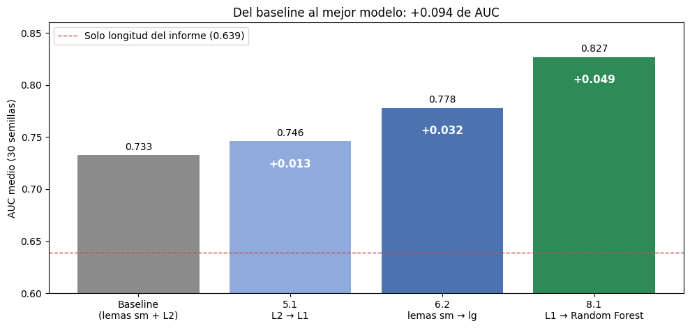

# Clasificación de notas clínicas oncológicas con PLN: ¿una o varias neoplasias?

Clasificación automática de notas clínicas reales en español (ya anonimizadas) de pacientes oncológicos, para detectar si cada paciente tiene **una única neoplasia o varias**. Hemos montado el flujo clásico de procesamiento del lenguaje natural (PLN) completo y hemos comparado muchas decisiones de preprocesado, representación y modelo con una evaluación estadística cuidadosa.

*Classification of real anonymized Spanish clinical oncology notes (single vs multiple neoplasms) with a classic NLP pipeline, BoW/TF-IDF/embeddings and several classifiers, evaluated with repeated cross-validation, permutation tests and nested cross-validation.*

🇬🇧 **English version:** [read it below](#english-version)

Lo hemos hecho como práctica individual de **Minería de Textos** del Grado en Ingeniería de la Salud (Universidad de Málaga, curso 2026/27).



## Datos

El corpus son 239 notas clínicas anonimizadas de pacientes oncológicos que nos dio la asignatura. **No se publican**: son datos clínicos reales cedidos solo para uso docente. Por eso el cuaderno de este repositorio no trae los datos, y en la versión pública hemos quitado las salidas y los comentarios que mostraban fragmentos de las notas. Todo lo demás (código, gráficas, tablas de resultados e interpretación) está completo.

## Qué hemos hecho

1. **Análisis exploratorio** del corpus: longitud de las notas, número de oraciones y de palabras según la clase.
2. **Preprocesado** con NLTK y spaCy: tokenización, stopwords, signos de puntuación, minúsculas, stemming y lematización.
3. **Representación** del texto con Bag of Words, n-gramas, TF-IDF y embeddings (Word2Vec, fastText y Doc2Vec).
4. **Modelos**: regresión logística L1 y L2, SVM lineal y RBF, Random Forest, Naive Bayes, red neuronal (MLP) y Gradient Boosting.
5. **Evaluación**: validación cruzada estratificada repetida con 30 semillas, tests de permutaciones, comparación con modelos triviales (azar y longitud del texto) y validación cruzada anidada para ajustar hiperparámetros sin sesgo.
6. **Interpretación**: palabras más importantes de cada modelo, estabilidad de esas palabras entre semillas y análisis de los falsos negativos.
7. **Umbral clínico**: hemos elegido el umbral de decisión pensando en el uso real, para no dejar escapar pacientes con varias neoplasias.

## Resultados principales

- El mejor modelo (lematización con spaCy, Bag of Words y Random Forest) sube el **AUC de 0.733 a 0.827** respecto al modelo base.
- Con el umbral elegido para la clínica detecta el **91 %** de los pacientes con varias neoplasias.
- Las palabras más útiles tienen sentido clínico, como *sincrónico*, *neoplasia* o *bilateral*.
- La mayoría de los errores son notas muy cortas o en las que la segunda neoplasia no aparece en el texto, así que no se arreglan cambiando el modelo.

| Curvas ROC de los modelos | Matriz de confusión del Random Forest |
|---|---|
|  |  |

## Estructura del repositorio

```
notebook_clasificacion_neoplasias.ipynb   cuaderno completo (sin los datos clínicos)
figuras/                                  todas las gráficas del cuaderno
```

## Cómo ejecutarlo

El cuaderno está pensado para Google Colab con Python 3 (pandas, scikit-learn, NLTK, spaCy, gensim, matplotlib y seaborn). Para ejecutarlo hace falta el fichero de datos de la asignatura, que no se incluye.

## Autor

Antonio Sánchez Doña.

---

## English version

Automatic classification of real Spanish clinical notes (already anonymised) from oncology patients, to detect whether each patient has **a single neoplasm or several**. We built the full classic natural language processing (NLP) pipeline and compared many preprocessing, representation and model choices with a careful statistical evaluation.

This was an individual assignment for **Text Mining** in the Health Engineering degree (University of Málaga, 2026/27).

### Data

The corpus is 239 anonymised clinical notes from oncology patients, provided by the course. **They are not published**: they are real clinical data shared only for teaching. That is why the notebook in this repository does not include the data, and in the public version we removed the outputs and comments that showed parts of the notes. Everything else (code, plots, result tables and interpretation) is complete.

### What we did

1. **Exploratory analysis** of the corpus: note length, number of sentences and number of words by class.
2. **Preprocessing** with NLTK and spaCy: tokenisation, stopwords, punctuation, lowercase, stemming and lemmatisation.
3. **Text representation** with Bag of Words, n-grams, TF-IDF and embeddings (Word2Vec, fastText and Doc2Vec).
4. **Models**: L1 and L2 logistic regression, linear and RBF SVM, Random Forest, Naive Bayes, a neural network (MLP) and Gradient Boosting.
5. **Evaluation**: stratified cross-validation repeated with 30 seeds, permutation tests, comparison with trivial models (chance and text length) and nested cross-validation to tune hyperparameters without bias.
6. **Interpretation**: most important words for each model, how stable those words are across seeds, and analysis of the false negatives.
7. **Clinical threshold**: we chose the decision threshold thinking about real use, so that patients with several neoplasms are not missed.

### Main results

- The best model (spaCy lemmatisation, Bag of Words and Random Forest) raises the **AUC from 0.733 to 0.827** compared with the baseline model.
- With the threshold chosen for clinical use it detects **91 %** of the patients with several neoplasms.
- The most useful words make clinical sense, such as *sincrónico* (synchronous), *neoplasia* (neoplasm) or *bilateral*.
- Most errors are very short notes, or notes where the second neoplasm is not mentioned in the text, so they cannot be fixed by changing the model.

### How to run it

The notebook is designed for Google Colab with Python 3 (pandas, scikit-learn, NLTK, spaCy, gensim, matplotlib and seaborn). Running it requires the course data file, which is not included.

### Author

Antonio Sánchez Doña.
