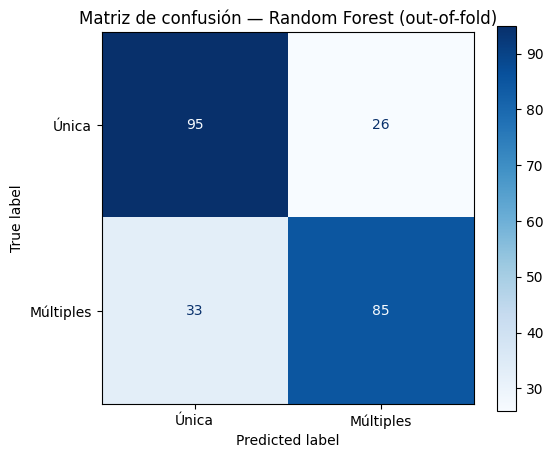

# Clasificación de notas clínicas oncológicas con PLN: ¿una o varias neoplasias?

Clasificación automática de notas clínicas reales en español (ya anonimizadas) de pacientes oncológicos, para detectar si cada paciente tiene **una única neoplasia o varias**. Hemos montado el flujo clásico de procesamiento del lenguaje natural (PLN) completo y hemos comparado muchas decisiones de preprocesado, representación y modelo con una evaluación estadística cuidadosa.

*Classification of real anonymized Spanish clinical oncology notes (single vs multiple neoplasms) with a classic NLP pipeline, BoW/TF-IDF/embeddings and several classifiers, evaluated with repeated cross-validation, permutation tests and nested cross-validation.*

Lo hemos hecho como práctica individual de **Minería de Textos** del Grado en Ingeniería de la Salud (Universidad de Málaga, curso 2026/27).


## Datos

El corpus son 239 notas clínicas anonimizadas de pacientes oncológicos que nos dio la asignatura. **No se publican**: son datos clínicos reales cedidos solo para uso docente. Por eso el cuaderno de este repositorio no trae los datos, y en la versión pública hemos quitado las salidas y los comentarios que mostraban fragmentos de las notas. Todo lo demás (código, gráficas, tablas de resultados e interpretación) está completo.

## Qué hemos hecho

1. **Análisis exploratorio** del corpus: longitud de las notas, número de oraciones y de palabras según la clase.
2. **Preprocesado** con NLTK y spaCy: tokenización, stopwords, signos de puntuación, minúsculas, stemming y lematización.
3. **Representación** del texto con Bag of Words, n-gramas, TF-IDF y embeddings (Word2Vec, fastText y Doc2Vec).
4. **Modelos**: regresión logística L1 y L2, SVM lineal y RBF, Random Forest, Naive Bayes, red neuronal (MLP) y Gradient Boosting.
5. **Evaluación**: validación cruzada estratificada repetida con 30 semillas, tests de permutaciones, comparación con modelos triviales (azar y longitud del texto) y validación cruzada anidada para ajustar hiperparámetros sin sesgo.
6. **Interpretación**: palabras más importantes de cada modelo, estabilidad de esas palabras entre semillas y análisis de los falsos negativos.
7. **Umbral clínico**: hemos elegido el umbral de decisión pensando en el uso real, para no dejar escapar pacientes con varias neoplasias.

## Resultados principales

- El mejor modelo (lematización con spaCy, Bag of Words y Random Forest) sube el **AUC de 0.733 a 0.827** respecto al modelo base.
- Con el umbral elegido para la clínica detecta el **91 %** de los pacientes con varias neoplasias.
- Las palabras más útiles tienen sentido clínico, como *sincrónico*, *neoplasia* o *bilateral*.
- La mayoría de los errores son notas muy cortas o en las que la segunda neoplasia no aparece en el texto, así que no se arreglan cambiando el modelo.

| Curvas ROC de los modelos | Matriz de confusión del Random Forest |
|---|---|
|  |  |

## Estructura del repositorio

```
notebook_clasificacion_neoplasias.ipynb   cuaderno completo (sin los datos clínicos)
figuras/                                  todas las gráficas del cuaderno
```

## Cómo ejecutarlo

El cuaderno está pensado para Google Colab con Python 3 (pandas, scikit-learn, NLTK, spaCy, gensim, matplotlib y seaborn). Para ejecutarlo hace falta el fichero de datos de la asignatura, que no se incluye.

## Autor

Antonio Sánchez Doña.
